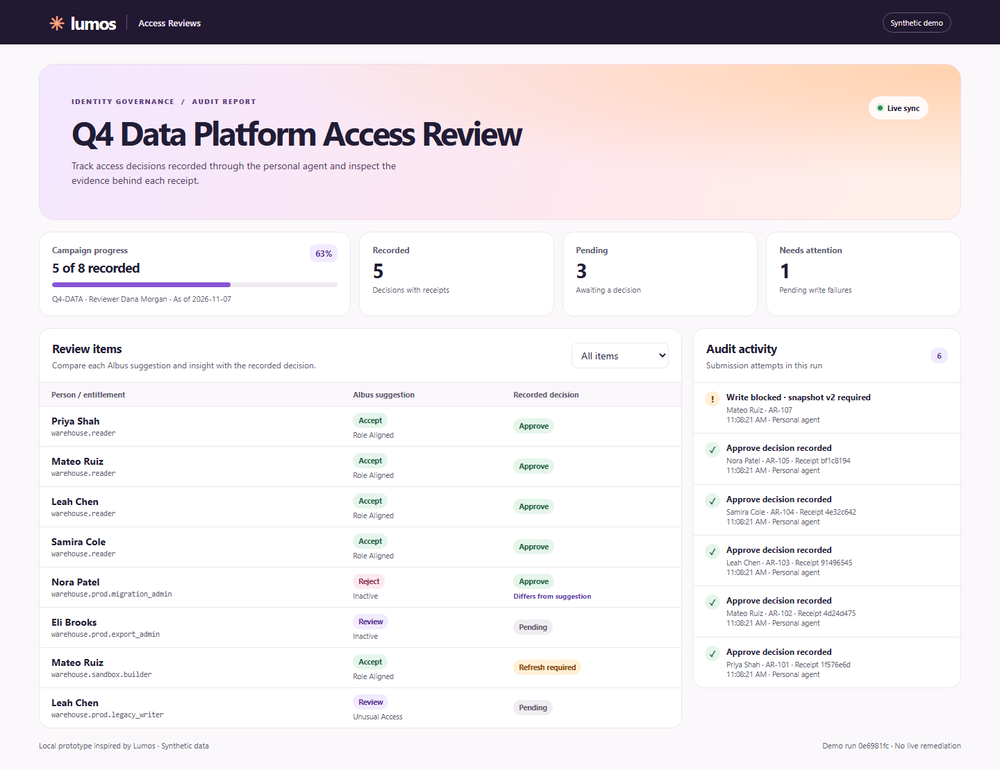

# Lumos access review demo

A synthetic Q4 warehouse access review for Codex desktop. Codex reasons over a personal workspace and calls a local Python stdio MCP server for assigned items, evidence and decisions. A browser report shows the same SQLite state as decisions land. The demo needs Python 3.10+ and uses the standard library.

## Try it

1. Clone or download this repository. With Codex and Python installed, register the connector from the repository root using the command below.
2. Start the local audit report and leave its browser tab open.
3. Open **personal-workspace** as a local project in Codex desktop and say **Help me complete my access review.**

### Register the connector once

Windows PowerShell:

```powershell
$demoPython = (Get-Command python).Source
$demoServer = (Resolve-Path .\server\src\main.py).Path
codex mcp add lumos_review_demo -- $demoPython $demoServer
```

macOS or Linux:

```sh
codex mcp add lumos_review_demo -- "$(command -v python3)" "$PWD/server/src/main.py"
```

[Codex MCP setup](https://learn.chatgpt.com/docs/extend/mcp?surface=cli)

### Open the audit report

```sh
python server/src/main.py report --open
```

Use `python3` on systems where that is the Python command. The report runs at [127.0.0.1:8765](http://127.0.0.1:8765/) and refreshes about once a second. Keep the process running during the demo. Use `--port` if 8765 is occupied. If you pass `--state` to the MCP server, point the report at the same file.

The report shows progress, original recommendations, recorded decisions and failed attempts. Select a person to inspect the reason, evidence versions and receipt. This read-only prototype is inspired by Lumos Access Reviews and runs on synthetic local data.

The synthetic campaign starts with five **Accept**, one **Reject**, and two **Review** suggestions. The report shows Albus insight categories such as **Role Aligned**, **Inactive**, and **Unusual Access** separately from the suggestion and the reviewer's recorded decision. [Lumos Agentic Access Reviews documentation](https://support.lumos.com/articles/9591496417-agentic-access-reviews-with-ai-driven-decisions)



## Start in one message

Open **personal-workspace** as a local project in Codex desktop. In a chat in that project, say:

> Help me complete my access review.

Codex calls `start_demo`, which clears the previous synthetic run and returns Dana Morgan's Q4-DATA campaign with eight pending items. Say the phrase again in the same chat to restart the review. Open a fresh chat if you also want a blank transcript. Then follow the [five-minute script](docs/demo-script.md).

If the tools are missing in an existing chat after registration, start a new chat in the project or restart Codex desktop. For a read-only connection check, ask Codex to call `list_my_reviews` directly.

## Operator controls

Run these from this folder in PowerShell.

~~~powershell
python .\server\src\main.py reset
python .\server\src\main.py advance-snapshot
python .\evaluation\verify.py
~~~

The command-line reset is an operator fallback and clears the same synthetic records as the trigger. Advance-snapshot changes only AR-107 and introduces an owner closure record, so an existing version 1 proposal becomes stale. The verifier uses temporary state and leaves presentation data alone.

## Optional Ask Albus

Register a separate **lumos_review_sim** server with the same launcher and append **--simulated-albus**. Use only one server per rehearsal and specify its name in the chat. Both modes use the same data and state by default. The optional mode returns canned, explicitly labeled investigations and uses zero model calls. Its evidence is also available through baseline search. It stores the scoped result without the shared personal excerpt. Use **--state path** for independent rehearsal state.

## Boundaries

The server scopes access to a fixed synthetic identity. The chat asks the reviewer to confirm the exact proposal. The server requires the client's confirmation assertion and records it as such. Directory separation illustrates how context moves. A local agent with broad filesystem access can still read sibling files. Revocation decisions and connector remediation are represented separately, with remediation set to `not_performed_in_simulation`.

[Tool contracts](docs/tool-contracts.md) · [Flow diagram](docs/diagrams.md) · [Lumos Access Reviews](https://www.lumos.com/products/access-reviews)
