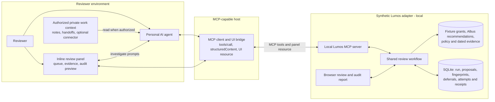
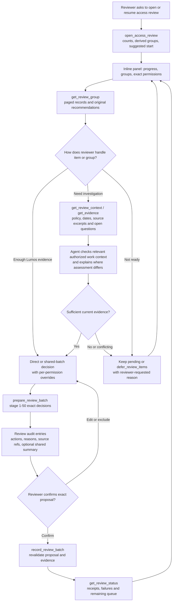
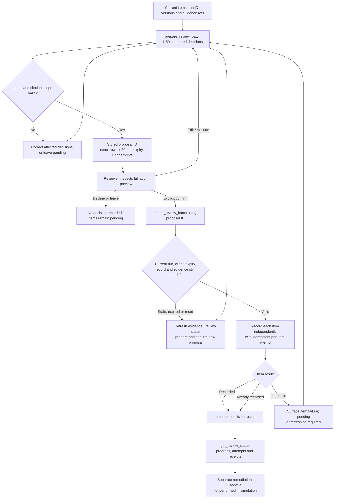
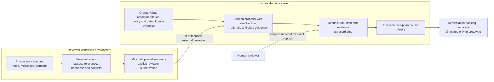
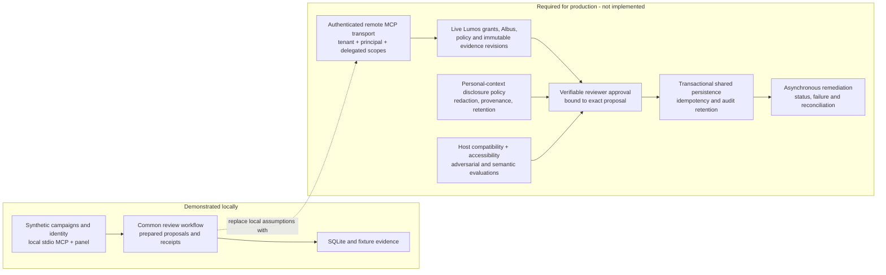

# Lumos access reviews — architecture and workflow diagrams

**Scope:** This document illustrates the **synthetic local prototype**, not a deployed Lumos integration. It complements the [interactive architecture in Miro](https://miro.com/app/board/uXjVESqFoRg=/?moveToWidget=3458764689933058696), [shared tool contracts](tool-contracts.md), [demo walkthrough](demo-script.md), and [production integration boundary](production-boundary.md).

The product idea is consistent across hosts and fixtures: **Lumos supplies authoritative access grants, Albus recommendations, policies, and dated evidence; a personal agent can add permitted reviewer-specific context; the human reviews an exact proposal; Lumos records decisions and receipts.** A chat conversation is useful for investigation, while the panel supports high-volume queue management and batch decisions.

**Notation:** Solid paths are represented in the local prototype. The last diagram explicitly labels additional production controls as **required / not implemented**. Diagram names represent logical roles; the fixture identity and SQLite state are *not* production identity or storage.

## 1. System context and trust boundaries

The inline panel and conversational agent reach the **same review workflow** through an MCP-capable host. The local browser report also uses that workflow against shared scenario state.



**Important:** The personal agent does not grant access. The server owns review records and decision recording. Actual downstream access removal is **simulated** and separate from the recorded decision. Private source excerpts should stay in the reviewer environment; the tool can receive only an optional, reviewer-authorized minimal summary, which Lumos labels as external information.
## 2. Reviewer experience — fast queue plus targeted investigation

The panel is deliberately **not** a hundred-message chatbot. Dynamic grouping, pagination, shared rationale, and individual overrides make routine work fast while leaving unclear items open.



**Product behavior:** Grouping is navigation based on recommendations and evidence; the interface must not imply the AI independently endorsed every grouped item. A deferral is not an approval, revocation, or change to underlying access.
## 3. MCP interaction sequence — investigation to audited decision

This is the detailed handoff between chat, UI, MCP tools and the shared review workflow. **Preparation is not submission.** The demo accepts client-reported confirmation; deployed verification must be stronger.

```mermaid
sequenceDiagram
  autonumber
  actor R as Reviewer
  participant P as Inline panel
  participant A as Personal agent
  participant H as Host MCP bridge
  participant L as Lumos MCP adapter
  participant W as Review workflow / SQLite
  participant C as Authorized work sources
  R->>A: Help me with my access review
  A->>H: open_access_review
  H->>L: tools/call
  L->>W: Read assigned synthetic campaign and group counts
  W-->>L: Run ID, review, groups and progress
  L-->>H: structuredContent + panel resource
  H-->>P: Render review overview
  R->>P: Open group and view evidence
  P->>H: get_review_group / get_review_context
  H->>L: tools/call
  L->>W: Read exact grants, recommendations, policy and evidence
  W-->>P: Evidence via MCP bridge
  R->>P: Investigate selected permission
  P->>A: ui/message with selected scope
  A->>H: get_review_context / get_evidence
  H->>L: tools/call
  L-->>A: Lumos evidence through host
  opt Reviewer authorized relevant external sources
    A->>C: Consult private context
    C-->>A: Relevant work facts, possibly conflicting
  end
  A-->>R: Explain evidence, uncertainty and proposed rationale
  opt Explicit authorization to share minimal external summary
    R-->>A: Approve proposed summary wording
  end
  A->>H: prepare_review_batch with exact rows and citations
  H->>L: tools/call
  L->>W: Validate scope, versions, cited sources; stage proposal
  W-->>L: Immutable proposal ID and expiry
  L-->>P: Preview via host bridge
  P-->>R: Review audit entries and edit or exclude
  alt Reviewer changes rows
    R->>P: Amend selection, decision or reason
    P->>H: prepare_review_batch with revised exact rows
    H->>L: tools/call
    L-->>P: New proposal through host
  else Reviewer confirms exact proposal
    R->>P: Confirm
    P->>H: record_review_batch(proposal_id)
    H->>L: tools/call
    L->>W: Recheck proposal, evidence and item fingerprints
    W-->>L: Per-item receipts or refresh-required failures
    L-->>P: Results via host
    P-->>R: Recorded decisions, unresolved items and receipts
  end
```

**Safety boundary:** The personal agent may reason using work context, but server-side evidence/version checks do **not** establish that the agent's semantic judgment is correct. Actual proof of human confirmation and permission enforcement across tenants require production integration.
## 4. Exact proposal lifecycle — edits, expiry and safe retries

The workflow is intentionally two-stage. A proposal is tied to the current run, campaign, reviewer, client profile, original recommendation and evidence fingerprint; edits create a **new proposal**. Recording can return partial results.



**Retry semantics:** When delivery is uncertain, retry the **same** confirmed proposal ID instead of creating a second write. Successful per-item receipts are recoverable; a stale or expired item needs refreshed evidence and new confirmation. This does not imply atomic, all-or-nothing batches.
## 5. Evidence provenance, privacy and audit responsibilities

The two evidence domains are intentionally distinct. **Lumos evidence** is authoritative for grants, recommendations and policy. **Work-context information** is independently assessed by the agent and must not be represented as Lumos-verified evidence.



**Limit:** The local tool schema does not guarantee that free text is redacted or privacy-safe. The reviewer/agent process must avoid transmitting raw private source excerpts; a production service needs its own disclosure controls, retention policy and provenance validation.
## 6. Production deployment gap — not built by this prototype

This diagram is **requirements architecture**, not a claim of deployed functionality. It separates what the demo proves from the work necessary before a real enterprise access review can safely run through customers' agents.



**First pilot boundary:** Focus on assigned reviewer decisions with human confirmation, not autonomous campaign scoping/launch or unrestricted agent delegation. See [production-boundary.md](production-boundary.md) for the release prerequisites and limitations.

## Demo and implementation references

- [Demo walkthrough](demo-script.md) — step-by-step review and exception investigation.
- [MCP tool contracts](tool-contracts.md) — exact tool names, proposal constraints and evidence rules.
- [Production integration boundary](production-boundary.md) — explicit local-versus-deployed limitations.
- [Miro implementation architecture](https://miro.com/app/board/uXjVESqFoRg=/?moveToWidget=3458764689933058696) — canvas view of the current local architecture.
